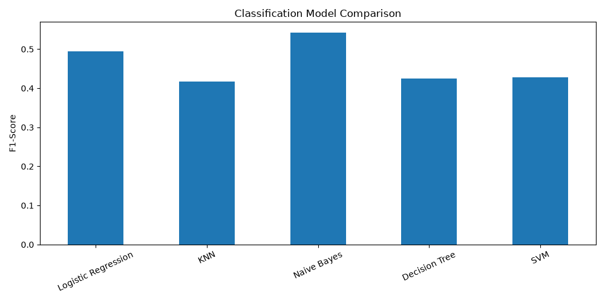
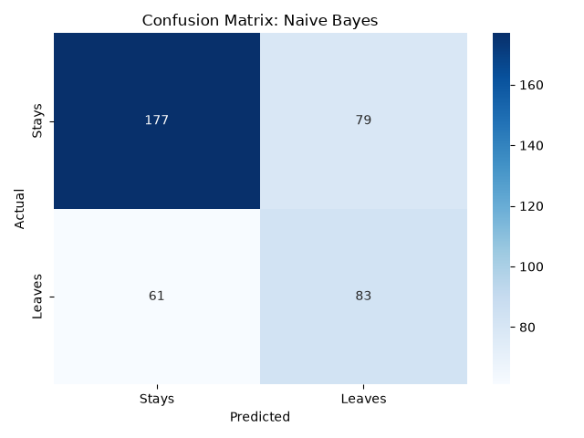

# Customer Churn Classification

A machine learning project that predicts whether a subscription customer is likely to **leave (churn)** or **stay**. It trains and compares five classification algorithms, saves the best model, and includes an interactive **Streamlit dashboard** for exploring results and making predictions.

> **Note:** This is an educational project. The dataset is **synthetic** (generated in code), so the results show the ML workflow, not real-world business performance.

---

## Features

- Generates a synthetic dataset of 2,000 customers with realistic churn patterns
- Preprocessing pipeline with feature scaling and one-hot encoding
- Trains and compares **5 classifiers** on the same train/test split
- Evaluates with Accuracy, Precision, Recall, F1-score and a Confusion Matrix
- Selects the best model by F1-score and saves it with `joblib`
- Streamlit app with a dashboard, live churn prediction, and model comparison charts

## Dataset

Synthetic data created with a fixed random seed (`42`) so results are reproducible.

| Feature | Type | Description |
|---|---|---|
| `tenure` | Numeric | Months as a customer (1-72) |
| `monthly_charges` | Numeric | Monthly bill amount (300-2000) |
| `support_calls` | Numeric | Number of support calls |
| `late_payments` | Numeric | Number of late payments |
| `contract_type` | Categorical | Monthly or Yearly |
| `internet_service` | Categorical | Fiber or DSL |
| `churn` | Target | 1 = customer left, 0 = customer stayed |

## Models and Results

All models are wrapped in a scikit-learn `Pipeline` (preprocessing + classifier) and evaluated on a held-out 20% test set (stratified split).

| Model | Accuracy | Precision | Recall | F1-Score |
|---|---|---|---|---|
| Logistic Regression | 0.668 | 0.546 | 0.451 | 0.494 |
| KNN (k=5) | 0.608 | 0.448 | 0.389 | 0.416 |
| **Naive Bayes** | 0.650 | 0.512 | **0.576** | **0.542** |
| Decision Tree (max_depth=6) | **0.675** | 0.585 | 0.333 | 0.425 |
| SVM (RBF kernel) | 0.673 | 0.576 | 0.340 | 0.428 |

**Best model by F1-score: Naive Bayes (0.542).** F1 was used for selection because churn is the minority class, so accuracy alone can be misleading. Naive Bayes catches the most churners (highest recall), while Decision Tree has the highest raw accuracy but misses more churners.

### Visual results




## Project Structure

```
Customer-Classification/
├── app.py                      # Streamlit dashboard
├── customer_classification.py  # Data generation, training, evaluation
├── customer_churn_model.pkl    # Saved best model (pipeline)
├── model_comparison.csv        # Test-set metrics for all models
├── model_comparison.png        # F1-score comparison chart
├── confusion_matrix.png        # Confusion matrix of the best model
├── requirements.txt            # Python dependencies
└── README.md
```

## Installation

```bash
git clone https://github.com/rituraj-811311/Customer-Classification.git
cd Customer-Classification
pip install -r requirements.txt
```

## Usage

**1. Train and evaluate the models** (regenerates the CSV, charts and saved model):

```bash
python customer_classification.py
```

**2. Launch the Streamlit dashboard:**

```bash
streamlit run app.py
```

The app has four pages:

- **Dashboard:** customer counts, churn rate, and distribution charts
- **Predict Customer:** enter customer details and get a churn probability
- **Model Comparison:** metrics table, charts, and confusion matrix
- **About Project:** algorithms, metrics, and technologies used

## Tech Stack

Python, NumPy, Pandas, Scikit-learn, Matplotlib, Seaborn, Joblib, Streamlit

## Limitations and Future Work

- Uses synthetic data; testing on a real dataset (for example the Telco Customer Churn dataset) would give meaningful results
- Recall for churners is modest, so class-imbalance handling (SMOTE, class weights) could help
- Add hyperparameter tuning with `GridSearchCV` and cross-validation
- Try ensemble models such as Random Forest or Gradient Boosting
- Deploy the app on Streamlit Community Cloud

## Author

**Rituraj Kumar**
[GitHub](https://github.com/rituraj-811311) | [LinkedIn](https://www.linkedin.com/in/rituraj-kumar-438886379/)
